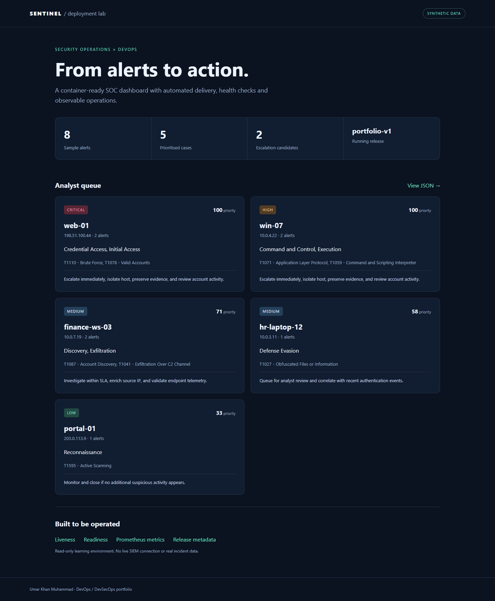
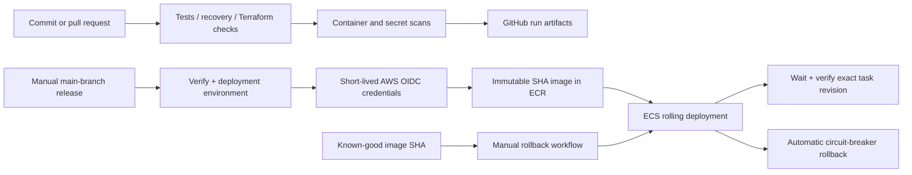
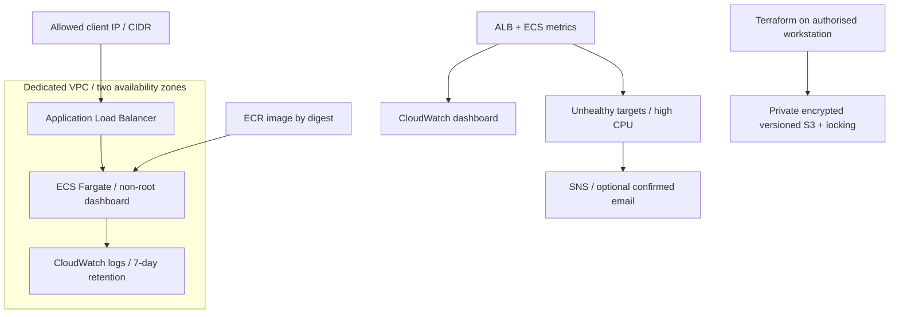

# DevOps Deployment Lab

[](https://github.com/Khanu123/devops-deployment-lab/actions/workflows/ci.yml)


A practical DevOps / DevSecOps portfolio project by **Umar Khan Muhammad**. This lab takes the triage logic from my [Sentinel SOC Dashboard](https://github.com/Khanu123/sentinel-soc-dashboard), serves a read-only web application, packages it in Docker, and provides AWS infrastructure, delivery pipelines, monitoring, and recovery procedures.

**Status:** Application and repository implementation complete. Local tests and recovery evidence are included; GitHub Actions verifies Linux containers and Terraform. AWS deployment is account-dependent and has **not** been performed or claimed. See [validation evidence](docs/validation.md).



## Employer review

| Skill | Concrete evidence |
| --- | --- |
| Linux and containers | Non-root container, read-only filesystem, dropped capabilities, health check, Compose resource limits |
| CI/CD | Tested builds, image and secret scans, retained run artifacts, manual AWS publishing/deployment |
| Infrastructure as code | Two Terraform roots, locked AWS provider, mock infrastructure tests, encrypted/versioned S3 state |
| AWS and IAM | ECR, ECS Fargate, ALB, VPC, restricted ingress, scoped execution role, GitHub OIDC |
| Observability | Structured request logs, Prometheus metrics, CloudWatch dashboard and alarms |
| Release recovery | Real process drill, Docker failed-candidate drill, immutable image rollback workflow |
| Operational judgement | [Runbook](docs/runbook.md), [security tradeoffs](docs/security.md), [costs and teardown](docs/costs-and-cleanup.md) |

Start with the [case study](docs/case-study.md), [latest CI run](https://github.com/Khanu123/devops-deployment-lab/actions), and [interview notes](INTERVIEW_NOTES.md).

## Run locally without installing packages

Requires Python 3.13 (the CI/container baseline); no third-party Python runtime packages are needed.

```bash
git clone https://github.com/Khanu123/devops-deployment-lab.git
cd devops-deployment-lab
python -m app.server
```

Open **http://127.0.0.1:8080**. This uses 8 synthetic alerts to produce 5 prioritised cases. No real Sentinel connection, customer data, account credentials, or external scans are used.

In another terminal:

```bash
python -m unittest discover -s tests -v
python scripts/smoke_test.py http://127.0.0.1:8080 --version local
python scripts/recovery_drill.py --output reports/local-recovery.json
```

The recovery drill starts separate real processes on a temporary port: accepts healthy `stable-v1`, rejects `broken-v2` with readiness 503, then restores `stable-v1`. It does not modify the app you started on port 8080.

## Run with Docker

Requires Docker Engine or Docker Desktop with Linux containers and Compose v2.

```bash
docker compose up --build -d --wait
python scripts/smoke_test.py http://127.0.0.1:8080 --version local
docker compose logs dashboard
docker compose down
```

Run the same container recovery check as CI in Bash (Linux, macOS, Git Bash, or WSL):

```bash
docker build --build-arg APP_VERSION=ci -t devops-lab:ci .
bash scripts/container_drill.sh
```

The stable container remains available while an unhealthy candidate is started on a separate port, rejected, and removed. This is a local candidate-rejection demonstration, not an AWS circuit-breaker test.

## Delivery architecture



The CI workflow runs without AWS credentials. AWS workflows require a configured `devops-lab` environment and run only from `main`. Publishing and deploying are manual to avoid accidental cloud charges.

## Cloud infrastructure



See [AWS setup](docs/aws-setup.md). Terraform manages infrastructure; delivery workflows manage service release revisions. Application ingress is restricted to the ALB security group. Public task IPs permit image pulls and logging without a NAT gateway; they do not permit direct inbound connections.

## HTTP endpoints

| Endpoint | Purpose |
| --- | --- |
| `/` | Responsive synthetic SOC dashboard |
| `/api/cases` | Read-only case data, explicitly marked synthetic |
| `/healthz` | Process liveness |
| `/readyz` | Readiness; returns 503 in the controlled failure drill |
| `/version` | Release identifier |
| `/metrics` | Prometheus-format request counts, uptime, and case count |

The metrics endpoint exposes data for a scraper; this lab does not deploy a Prometheus server. CloudWatch uses AWS service metrics and application logs.

## Repository layout

```text
app/                       HTTP app, styling, adapted triage logic
sample_data/               Synthetic alert fixture
tests/                     Triage, HTTP, and deployment-behaviour tests
scripts/                   Smoke test, recovery drills, AWS deployment helper
infra/bootstrap/           ECR, S3 state, GitHub OIDC and release role
infra/main/                VPC, ALB, ECS, runtime IAM and monitoring
.github/workflows/         CI, manual publication/deployment and rollback
docs/                      Evidence, screenshots, architecture and runbooks
reports/                   Actual local/CI validation evidence
```

## Limits

This is a small learning lab. Its Python standard-library HTTP server, single desired ECS task, and optional restricted HTTP listener are suitable for synthetic demonstrations, not a production SOC platform. Production would need a production server, authentication, TLS, private subnet design, stronger availability, load testing, and operational ownership. [Security notes](docs/security.md) explain the choices and the advisory IaC scan.

## Attribution and references

The original triage logic and fixtures were adapted from my Sentinel project at commit [`4e56d451`](https://github.com/Khanu123/sentinel-soc-dashboard/commit/4e56d451ecca17767109460dcbaf639c9555844b). The HTTP application, container configuration, cloud infrastructure, release tooling and operational documentation are added in this repository.

- [GitHub AWS OIDC documentation](https://docs.github.com/en/actions/how-tos/secure-your-work/security-harden-deployments/oidc-in-aws)
- [AWS ECS deployment circuit breaker](https://docs.aws.amazon.com/AmazonECS/latest/developerguide/deployment-circuit-breaker.html)
- [Terraform S3 backend and state locking](https://developer.hashicorp.com/terraform/language/backend/s3)
